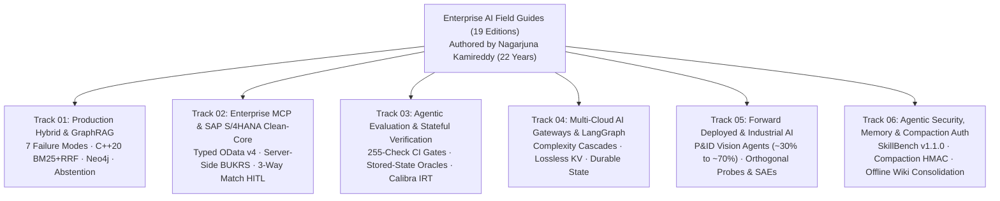

# Enterprise AI Field Guides & Architecture Monographs (`v1.1.0`)

[](https://github.com/nagarjunak-pixel/enterprise-ai-field-guides/actions/workflows/ci.yml)
[](LICENSE)
[](https://nagarjunak-pixel.github.io/handbooks.html)

**Open-Access Practitioner Field Guides (`12` Pages) & Executive Technical Monographs Authored by Nagarjuna Kamireddy (Lead AI Architect · 22 Years Enterprise Data, SAP HANA & Production AI).**

Every guide distills concrete production patterns, deterministic code guardrails, and evaluation gates from **22 years** of enterprise IT delivery — spanning **12 years** of global SAP HANA, BW, and BPC transformations (GSK UK, PETRONAS Energy Trading `48h → 12m`, DHL) and **10 years** of Machine Learning, GenAI, and Agentic AI leadership (**23+ production AI initiatives**, **750K+ automated requests**, and **42K+ hours saved in FY26** at John Deere).

---

## Six-Track Architecture Map



---

## Complete Field-Guide & Monograph Catalog (19 Open-Access PDFs · Zero Email Wall)

| Track | PDF Field Guide / Monograph | 1-Click Web Download | Companion Public Reference Code |
| :--- | :--- | :--- | :--- |
| **Board & C-Suite Brief** | [**The AI Trust Stack — 5 Layers Every Board Should Demand Before Scaling AI Agents**](track-06-agentic-security-finops/The_AI_Trust_Stack_Board_Brief_Nagarjuna_Kamireddy.pdf) (`8p` Board Brief PDF: *Identity · Permissions · Evaluation · Monitoring · Verification*) | [Web Mirror](https://nagarjunak-pixel.github.io/field-guides/The_AI_Trust_Stack_Board_Brief_Nagarjuna_Kamireddy.pdf) | [aegis-runtime](https://github.com/nagarjunak-pixel/aegis-runtime) · [skillbench](https://github.com/nagarjunak-pixel/skillbench) |
| **Track 01** | [FG-01: Production Hybrid & GraphRAG — Seven Enterprise Failure Modes & Deterministic Fixes](track-01-production-rag/FG01_Production_Hybrid_GraphRAG_Failure_Modes_Nagarjuna_Kamireddy.pdf) (`12p` PDF) | [Web Mirror](https://nagarjunak-pixel.github.io/field-guides/FG01_Production_Hybrid_GraphRAG_Failure_Modes_Nagarjuna_Kamireddy.pdf) | [enterprise-helpdesk-rag-guardrails](https://github.com/nagarjunak-pixel/enterprise-helpdesk-rag-guardrails) · [vecta](https://github.com/nagarjunak-pixel/vecta) |
| **Track 02** | [FG-02: Enterprise MCP Servers & SAP S/4HANA Clean-Core OData Architecture](track-02-enterprise-mcp-sap-odata/FG02_Enterprise_MCP_SAP_S4HANA_Clean_Core_OData_Nagarjuna_Kamireddy.pdf) (`12p` PDF) | [Web Mirror](https://nagarjunak-pixel.github.io/field-guides/FG02_Enterprise_MCP_SAP_S4HANA_Clean_Core_OData_Nagarjuna_Kamireddy.pdf) | [enterprise-erp-odata-mcp-server](https://github.com/nagarjunak-pixel/enterprise-erp-odata-mcp-server) |
| **Track 02** | [SAP S/4HANA, Clean-Core OData MCP & Governed Enterprise AI (Executive Monograph)](track-02-enterprise-mcp-sap-odata/Nagarjuna_Kamireddy_SAP_Enterprise_AI_Handbook.pdf) (`3p` PDF) | [Web Mirror](https://nagarjunak-pixel.github.io/handbooks/Nagarjuna_Kamireddy_SAP_Enterprise_AI_Handbook.pdf) | [enterprise-erp-odata-mcp-server](https://github.com/nagarjunak-pixel/enterprise-erp-odata-mcp-server) |
| **Track 03** | [FG-03: Agentic Evaluation, AI Control & 255-Check CI Release Gates](track-03-agentic-evals-guardrails/FG03_Agentic_Evaluation_AI_Control_255_CI_Gates_Nagarjuna_Kamireddy.pdf) (`12p` PDF) | [Web Mirror](https://nagarjunak-pixel.github.io/field-guides/FG03_Agentic_Evaluation_AI_Control_255_CI_Gates_Nagarjuna_Kamireddy.pdf) | [verispec-sdd](https://github.com/nagarjunak-pixel/verispec-sdd) · [calibra](https://github.com/nagarjunak-pixel/calibra) · [tracegit](https://github.com/nagarjunak-pixel/tracegit) |
| **Track 03** | [FG-08: Stored-State Differential Oracles, Calibrated Evaluators & Edge Delegation](track-03-agentic-evals-guardrails/FG08_Stored_State_Oracles_Calibrated_Evaluators_Edge_Delegation_Nagarjuna_Kamireddy.pdf) (`12p` PDF) | [Web Mirror](https://nagarjunak-pixel.github.io/field-guides/FG08_Stored_State_Oracles_Calibrated_Evaluators_Edge_Delegation_Nagarjuna_Kamireddy.pdf) | [verispec-sdd](https://github.com/nagarjunak-pixel/verispec-sdd) · [calibra](https://github.com/nagarjunak-pixel/calibra) · [syntara](https://github.com/nagarjunak-pixel/syntara) · [prism-gate](https://github.com/nagarjunak-pixel/prism-gate) |
| **Track 03** | [Agent Evaluation, Golden Datasets, Retries & Circuit Breakers](track-03-agentic-evals-guardrails/Nagarjuna_Kamireddy_Agent_Evaluation_Reliability_Handbook.pdf) (`3p` PDF) | [Web Mirror](https://nagarjunak-pixel.github.io/handbooks/Nagarjuna_Kamireddy_Agent_Evaluation_Reliability_Handbook.pdf) | [verispec-sdd](https://github.com/nagarjunak-pixel/verispec-sdd) |
| **Track 04** | [FG-05: Multi-Cloud AI Gateways, Subtask FinOps & Lossless KV Serving](track-04-ai-gateways-langgraph/FG05_Multi_Cloud_AI_Gateways_FinOps_Lossless_KV_Nagarjuna_Kamireddy.pdf) (`12p` PDF) | [Web Mirror](https://nagarjunak-pixel.github.io/field-guides/FG05_Multi_Cloud_AI_Gateways_FinOps_Lossless_KV_Nagarjuna_Kamireddy.pdf) | [prism-gate](https://github.com/nagarjunak-pixel/prism-gate) · [weavegraph](https://github.com/nagarjunak-pixel/weavegraph) |
| **Track 04** | [Enterprise AI Gateways, Multi-Model Routing, vLLM & LangGraph](track-04-ai-gateways-langgraph/Nagarjuna_Kamireddy_AI_Gateways_LangGraph_Handbook.pdf) (`3p` PDF) | [Web Mirror](https://nagarjunak-pixel.github.io/handbooks/Nagarjuna_Kamireddy_AI_Gateways_LangGraph_Handbook.pdf) | [prism-gate](https://github.com/nagarjunak-pixel/prism-gate) |
| **Track 04** | [Model Context Protocol (MCP), Context Engineering & Multi-Agent Systems](track-04-ai-gateways-langgraph/Nagarjuna_Kamireddy_MCP_Context_Engineering_Handbook.pdf) (`3p` PDF) | [Web Mirror](https://nagarjunak-pixel.github.io/handbooks/Nagarjuna_Kamireddy_MCP_Context_Engineering_Handbook.pdf) | [weavegraph](https://github.com/nagarjunak-pixel/weavegraph) |
| **Track 05** | [FG-06: Forward Deployed AI — Multimodal Rescue, Orthogonal Probes & SAE Circuits](track-05-fde-system-design/FG06_Forward_Deployed_AI_Orthogonal_Probes_SAE_Interpretability_Nagarjuna_Kamireddy.pdf) (`12p` PDF) | [Web Mirror](https://nagarjunak-pixel.github.io/field-guides/FG06_Forward_Deployed_AI_Orthogonal_Probes_SAE_Interpretability_Nagarjuna_Kamireddy.pdf) | [calibra](https://github.com/nagarjunak-pixel/calibra) · [syntara](https://github.com/nagarjunak-pixel/syntara) · [aegis-runtime](https://github.com/nagarjunak-pixel/aegis-runtime) |
| **Track 05** | [Generative & Agentic AI for Engineering Documentation (Energy, Oil, Gas & Heavy Industry)](track-05-fde-system-design/Nagarjuna_Kamireddy_GenAI_Oil_Gas_Engineering_Docs_Deck.pdf) (`6p` PDF) | [Web Mirror](https://nagarjunak-pixel.github.io/handbooks/Nagarjuna_Kamireddy_GenAI_Oil_Gas_Engineering_Docs_Deck.pdf) | [enterprise-helpdesk-rag-guardrails](https://github.com/nagarjunak-pixel/enterprise-helpdesk-rag-guardrails) |
| **Track 06** | [FG-04: Agentic Supply-Chain Security, SKILL.md Taint & CaMeL MCP Firewalls](track-06-agentic-security-finops/FG04_Agentic_Supply_Chain_SKILL_Taint_CaMeL_MCP_Firewall_Nagarjuna_Kamireddy.pdf) (`12p` PDF) | [Web Mirror](https://nagarjunak-pixel.github.io/field-guides/FG04_Agentic_Supply_Chain_SKILL_Taint_CaMeL_MCP_Firewall_Nagarjuna_Kamireddy.pdf) | [skillbench](https://github.com/nagarjunak-pixel/skillbench) · [aegis-runtime](https://github.com/nagarjunak-pixel/aegis-runtime) |
| **Track 06** | [FG-07: Long-Horizon Agent Memory, Offline Consolidation & Compaction Security](track-06-agentic-security-finops/FG07_Long_Horizon_Agent_Memory_Consolidation_Compaction_Security_Nagarjuna_Kamireddy.pdf) (`12p` PDF) | [Web Mirror](https://nagarjunak-pixel.github.io/field-guides/FG07_Long_Horizon_Agent_Memory_Consolidation_Compaction_Security_Nagarjuna_Kamireddy.pdf) | [aegis-runtime](https://github.com/nagarjunak-pixel/aegis-runtime) · [tracegit](https://github.com/nagarjunak-pixel/tracegit) · [weavegraph](https://github.com/nagarjunak-pixel/weavegraph) · [llm-knowledge-base](https://github.com/nagarjunak-pixel/llm-knowledge-base) |
| **Track 06** | [Securing AI Agents, Prompt-Injection Defence & HITL Guardrails](track-06-agentic-security-finops/Nagarjuna_Kamireddy_Securing_AI_Agents_Guardrails_Handbook.pdf) (`2p` PDF) | [Web Mirror](https://nagarjunak-pixel.github.io/handbooks/Nagarjuna_Kamireddy_Securing_AI_Agents_Guardrails_Handbook.pdf) | [skillbench](https://github.com/nagarjunak-pixel/skillbench) |

---

## Automated Metadata & Quality Verification

```bash
python3 scripts/verify_guides.py
```

---

## Author

**Nagarjuna Kamireddy** — Lead AI Architect | AI Solutions Architect | GenAI Lead — Agentic AI & RAG (`22 years` enterprise IT experience)  
- **Free Web Library:** [https://nagarjunak-pixel.github.io/handbooks.html](https://nagarjunak-pixel.github.io/handbooks.html)  
- **Architecture Portfolio:** [https://nagarjunak-pixel.github.io](https://nagarjunak-pixel.github.io)  
- **LinkedIn:** [https://www.linkedin.com/in/nagarjuna-kamireddy/](https://www.linkedin.com/in/nagarjuna-kamireddy/)  
- **Contact:** `writetonagarjuna@gmail.com`

- **FG-09 (`track-01-production-rag/FG09_Post_Retrieval_RAG_BiTemporal_Memory_RRF_Cascades_Nagarjuna_Kamireddy.pdf`):** Post-Retrieval Enterprise RAG: Bi-Temporal Memory, Pruned RRF Cascades & Cross-Page Stitching (`llm-knowledge-base v1.1.0`, `vecta`, `enterprise-helpdesk-rag-guardrails`)
- **FG-10 (`track-04-ai-gateways-langgraph/FG10_AI_Inference_FinOps_SLO_Goodput_MaaS_Assurance_Nagarjuna_Kamireddy.pdf`):** AI Inference Economics, Multi-Tenant SLO Goodput & MaaS Assurance (`prism-gate`, `aegis-runtime v1.1.0`, `calibra`, `langgraph-newsroom v1.1.0`)
- **FG-11 (`track-02-enterprise-mcp-sap-odata/FG11_Financial_Grade_Agentic_Verification_Cost_Sensitive_SQL_Nagarjuna_Kamireddy.pdf`):** Financial-Grade Agentic Verification: Amount-Scaled Decision Layers, Counterfactual SQL & Clean-Core ERP Controls (`syntara v1.1.0`, `enterprise-erp-odata-mcp-server`, `company-os v1.1.0`)
- **FG-12 (`track-06-agentic-security-finops/FG12_Zero_Egress_Agent_Sandboxes_Multi_Actor_Authority_Nagarjuna_Kamireddy.pdf`):** Zero-Egress Agent Sandboxes & Multi-Actor Authority: Secret Brokers, Bounded Decision Gateways & Sliced Prefill (`aegis-runtime v1.2.0`, `prism-gate v1.1.0`, `skillbench`)
